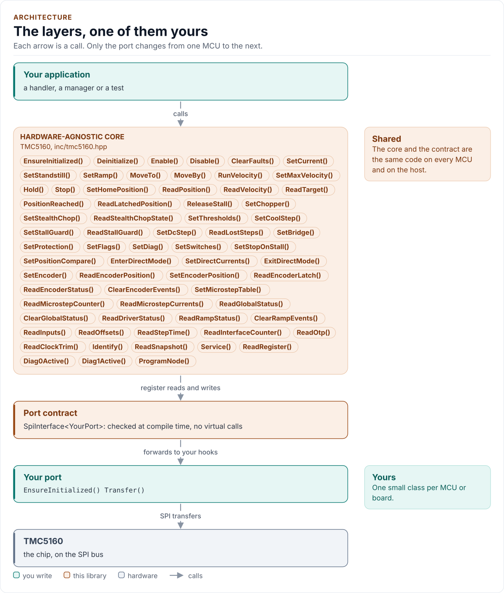
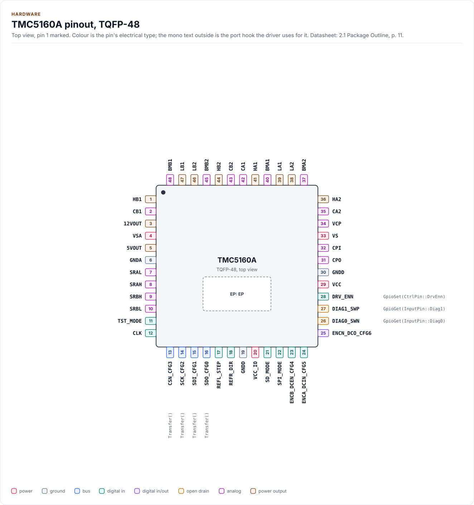
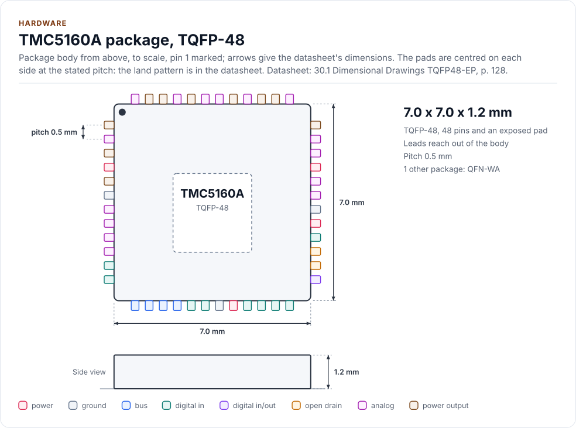
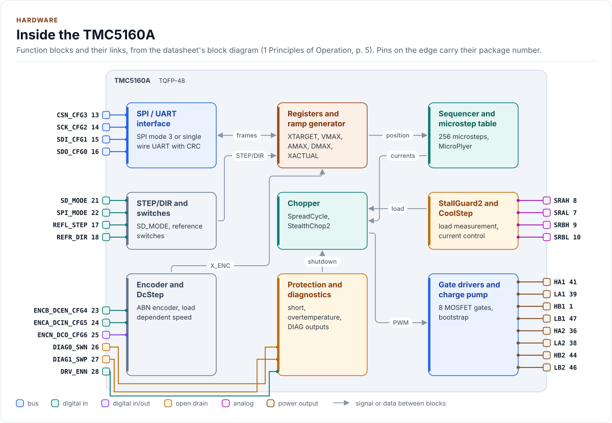

# TMC5160 Driver

C++20 driver for the Trinamic TMC5160 and TMC5160A stepper motor controller and driver with SPI and UART interfaces

[](https://github.com/kokeb-labs-drivers/driver-tmc5160/actions/workflows/ci.yml)
[](LICENSE)
[](docs/installation.md#requirements)

**Documentation: [`docs/`](docs/index.md)**, with the API reference built by Doxygen ([how](docs/api-reference.md)).
The site at <https://kokeb-labs-drivers.github.io/driver-tmc5160/> opens when the repository is public.

The TMC5160 is a stepper motor controller and driver for two-phase motors: a ramp generator, a sequencer with a
256-entry microstep table, two chopper modes (StealthChop2 and SpreadCycle), StallGuard2 and CoolStep load sensing,
DcStep, an encoder input and the gate drivers for an external MOSFET bridge. This driver starts it safely, moves the
motor with a typed API in physical units, and refuses the register writes that can burn out a motor or a bridge:
the current is always tied to the motor and sense resistor you declare. It runs on any MCU: you give it a small class
that moves bytes on your SPI or UART bus, and it does the rest.

<!-- figure: driver-layers -->
<picture>
  <source media="(prefers-color-scheme: dark)" srcset="docs/diagrams/driver-layers.dark.svg">
  
</picture>
<!-- /figure -->

## At a glance

| | |
| --- | --- |
| **Chip** | TMC5160 and TMC5160A, 10 V to 55 V motor supply, up to 20 A peak with external MOSFETs |
| **Moves** | Ramp generator with position and velocity modes, or STEP/DIR with MicroPlyer |
| **Bus** | SPI mode 3, up to 4 MHz on the internal clock, daisy chain; or single wire UART with CRC-8 |
| **Safety** | Current tied to the declared motor and `Rsense`; a guard and an explicit acknowledgement for each dangerous write |
| **Driver** | Header-only C++20; no heap, exceptions, RTTI or virtual calls; every call returns `Result<T>` |
| **Runs on** | Any MCU with SPI or UART and a C++20 compiler; the host examples run on any PC ([Platforms](docs/platforms.md)) |
| **Status** | 0.1.0, not yet verified on hardware: host-tested against an independent model of the chip |

<!-- figure: chip-pinout -->
<picture>
  <source media="(prefers-color-scheme: dark)" srcset="docs/diagrams/chip-pinout.dark.svg">
  
</picture>
<!-- /figure -->

<!-- figure: chip-outline -->
<picture>
  <source media="(prefers-color-scheme: dark)" srcset="docs/diagrams/chip-outline.dark.svg">
  
</picture>
<!-- /figure -->

<!-- figure: chip-blocks -->
<picture>
  <source media="(prefers-color-scheme: dark)" srcset="docs/diagrams/chip-blocks.dark.svg">
  
</picture>
<!-- /figure -->

<!-- generated: chip-card -->
| | | Datasheet |
| --- | --- | --- |
| **Package** | TQFP-48, exposed pad | 2.1, p. 11 |
| **Pins** | 48 | 2.1, p. 11 |
| **Body size** | 7.0 x 7.0 x 1.2 mm | 30.1, p. 128 |
| **Pin pitch** | 0.5 mm | 30.1, p. 128 |
| **Variants** | `qfn-wa` (below) | 30.2, p. 130 |
| **Supply VS** | 10.0 V to 55.0 V | 28.1, p. 120 |
| **Supply VSA** | 10.0 V to 50.0 V | 28.1, p. 120 |
| **Supply VCC_IO** | 3.0 V to 5.25 V | 28.1, p. 120 |

Also sold as:

| Variant | Package | Pins | Size | Ordering | Note | Datasheet |
| --- | --- | --- | --- | --- | --- | --- |
| `qfn-wa` | QFN-WA | 47 | 8.0 x 8.0 x 0.85 mm | TMC5160A-WA | wettable flanks, exposed pad 6.25 x 6.25 mm; the datasheet calls it QFN56 but numbers 47 pins | 30.2, p. 130 |

From [`docs/hardware.yml`](docs/hardware.yml); pins, circuits and the block diagram: [Hardware](docs/hardware.md).
<!-- /generated -->

## Datasheet

<!-- generated: datasheet-card -->
| Document | Revision | Get it |
| --- | --- | --- |
| Datasheet: TMC5160 / TMC5160A Datasheet (Analog Devices (Trinamic) TMC5160A-DS) | 1.18, 2023-03-01 | [vendor page](https://www.analog.com/media/en/technical-documentation/data-sheets/TMC5160A_datasheet_rev1.18.pdf) |

Written against these revisions; the SHA-256 of each file is in [`docs/datasheets.yml`](docs/datasheets.yml). Where each
part of the driver is in the datasheet: [Datasheet map](docs/datasheet.md).
<!-- /generated -->

Every docs page lists the datasheet sections it relies on, and code comments cite the section they implement.

## Try it on your PC

No hardware needed: [`examples/host`](examples/host/README.md) has eleven programs that run the driver against a
simulated chip. You need git, CMake 3.16+ and a C++20 compiler (GCC 10+, Clang 13+ or MSVC 2022).

1. Get the source:

   ```bash
   git clone https://github.com/kokeb-labs-drivers/driver-tmc5160.git && cd driver-tmc5160
   ```

2. Build and run the quickstart:

   ```bash
   cmake -S examples/host -B build-example
   cmake --build build-example
   ./build-example/tmc5160_host_quickstart
   ```

3. You should see the driver start the simulated chip and move 20000 microsteps:

   ```text
   TMC5160 driver 0.1.0 on the host
   tmc5160: initialised
   position 20000
   ```

The other programs show ramps, StealthChop, StallGuard2, homing, an encoder, a UART chain, an SPI chain, direct mode
and DIAG handling ([Examples](docs/examples.md)). To run the whole test suite instead:
`cmake -S . -B build -DTMC5160_BUILD_TESTS=ON && cmake --build build && ctest --test-dir build`.

## Use it on your MCU

**1. Wire it** ([Hardware](docs/hardware.md) has every pin, the timing and the power). SPI:

| MCU | TMC5160 | Notes |
| --- | --- | --- |
| SPI SCK | SCK_CFG2 | Mode 3, up to 4 MHz on the internal clock; 1 MHz for bring-up on jumper wires |
| SPI MOSI | SDI_CFG1 | |
| SPI MISO | SDO_CFG0 | |
| GPIO (chip select) | CSN_CFG3 | Low for the whole frame: one transfer per frame |
| GPIO | DRV_ENN | Optional but recommended: the driver switches the power stage with it |
| GPIO (input) | DIAG0_SWN | Optional: an interrupt for errors and events |
| 3.3 V | VCC_IO | 3.0 V to 5.25 V; 100 nF to GND at the pin |
| GND | GNDD, GNDA, pad | `SPI_MODE` high, `SD_MODE` low, `CLK` low for the internal clock |

The motor supply (VS, 10 V to 55 V) and the bridge are wired as in the datasheet's sample circuit.

**2. Write the port**: a class with `EnsureInitialized()` (bring the bus up), `Transfer()` (one full-duplex frame
with CSN low) and `DelayUs()`, about 20 lines on most SDKs; a UART port has `Exchange()` instead of `Transfer()`.
[Porting](docs/porting.md) has the contract and complete examples.

**3. Declare the motor and move it:**

<!-- generated: quickstart-code -->
```cpp
#include "tmc5160.hpp"

int spin_one_revolution(MyPort& port) {
  // 1. Declare the motor and the board. The driver derives every current register from these two.
  const tmc5160::Config config =
      tmc5160::MakeConfig(tmc5160::Motor{.rated_rms_ma = 1000, .coil_resistance_mohm = 6000},
                          tmc5160::Board{.rsense_mohm = 100, .supply_mv = 24'000});
  tmc5160::TMC5160<MyPort> motor(port, config); // no I/O yet

  if (auto r = motor.EnsureInitialized();
      !r) {                           // 2. bus, strap, VERSION, every register, driver off
    return static_cast<int>(r.error); //    Bus, Timeout, DeviceIdMismatch, InvalidArgument ...
  }
  if (auto r = motor.Enable(); !r) { // 3. DRV_ENN active, TOFF written
    return static_cast<int>(r.error);
  }
  if (auto r = motor.MoveTo(51'200); !r) { // 4. one revolution at 256 microsteps, 200 full steps
    return static_cast<int>(r.error);
  }
  return 0; // poll PositionReached(); Disable() when done
}
```
<!-- /generated -->

`EnsureInitialized()` is the only call that starts the chip. Every other call returns `Error::NotInitialized` until it
has succeeded. `Config{}` is not a usable configuration: the motor and the sense resistor have no safe default, so
`MakeConfig()` needs both, and `Validate()` rejects anything that would drive more current than the motor allows.

## What it does

- Starts the chip with the strap, version and status checks, then writes every register from one `Config`.
- Derives GLOBALSCALER, IRUN and IHOLD from the motor's current and the sense resistor, never above the motor.
- Moves in position or velocity mode with physical units, and stops by any of four stop kinds.
- Exposes StealthChop2 with its automatic tuning wait, SpreadCycle, StallGuard2, CoolStep, DcStep, the encoder,
  direct mode and the microstep table, each behind a guard.
- Keeps a write-through shadow of the write-only registers; reading one returns `Error::Refused`.
- Works over SPI (also in a daisy chain) and over UART (also with several nodes); STEP/DIR mode is supported.
- Returns `Result<T>` with an `Error` from every call: no exceptions, no heap, no RTTI, no virtual calls.

## Add it to your project

Pick the row that matches your build; each is a few steps, and [Installation](docs/installation.md) has the
details.

| Your build | Steps below |
| --- | --- |
| Plain CMake: STM32 (CubeMX), RP2040 (Pico SDK), nRF Connect, a host app | [A](#a-cmake-any-mcu) |
| ESP-IDF | [B](#b-esp-idf) |
| An SDK or OS image that installs libraries | [C](#c-installed-package) |

### A. CMake, any MCU

1. Add the driver as a submodule, pinned to the version you chose:

   ```bash
   git submodule add https://github.com/kokeb-labs-drivers/driver-tmc5160.git external/driver-tmc5160
   ```

2. In your `CMakeLists.txt`, after `project()`:

   ```cmake
   add_subdirectory(external/driver-tmc5160)
   target_link_libraries(my_app PRIVATE tmc5160::tmc5160)   # brings the headers and C++20
   ```

3. In your code, `#include "tmc5160.hpp"`, write the port ([Porting](docs/porting.md)) and build. A first build
   that compiles the quickstart above is the check that the driver is wired in.

### B. ESP-IDF

1. Add the driver under your project's `components/`; ESP-IDF finds it there and names it after the folder:

   ```bash
   git submodule add https://github.com/kokeb-labs-drivers/driver-tmc5160.git components/tmc5160
   ```

2. In `main/CMakeLists.txt`, list it: `idf_component_register(SRCS "main.cpp" REQUIRES tmc5160)`.
3. `idf.py menuconfig` now has a **TMC5160 stepper driver** menu (motor current, sense resistor, supply,
   run and hold current, microsteps),
   and `idf.py build` builds the driver with your app. [`examples/esp32`](examples/esp32) is a complete
   project with a port for the board.

### C. Installed package

1. Install it once into a prefix:

   ```bash
   cmake -S external/driver-tmc5160 -B build-tmc5160 && cmake --install build-tmc5160 --prefix /opt/sdk
   ```

2. In your project, with `CMAKE_PREFIX_PATH=/opt/sdk`:

   ```cmake
   find_package(tmc5160 0.1 REQUIRED)
   target_link_libraries(my_app PRIVATE tmc5160::tmc5160)
   ```

The target is `tmc5160::tmc5160` every way, so switching later changes nothing else.

## Documentation

| Page | Read it when you want to |
| --- | --- |
| [Quickstart](docs/quickstart.md) | Go from a bare chip to a moving motor on your MCU |
| [Hardware](docs/hardware.md) | Wire it, check the bus settings, the timing and the power |
| [Porting](docs/porting.md) | Write the SPI or UART port class for your MCU's SDK |
| [API guide](docs/api-guide.md) | Use each call: start, current, move, tune, diagnose, handle errors |
| [Current and limits](docs/current-and-limits.md) | See how the motor current is derived and bounded |
| [Guards and acknowledgements](docs/guards.md) | Know which writes are refused and how to lift a guard per call |
| [Configuration](docs/configuration.md) | Choose every setting, or take the menuconfig values |
| [Troubleshooting](docs/troubleshooting.md) | Find the cause of an error or a motor that does not move |
| [Ambiguities](docs/ambiguities.md) | See where the datasheet is unclear and which reading the driver takes |
| [Contract](docs/contract.md) | Know exactly what the driver promises, needs and returns |
| [Datasheet map](docs/datasheet.md) | Find the datasheet section behind each part of the driver |
| [Coverage map](docs/coverage.md) | See every register, bit, mode, pin and rating and where it is handled |
| [API reference](docs/api-reference.md) | Look up a class or member (Doxygen; built by CI and locally) |

## Tests and quality

```bash
cmake -S . -B build -DTMC5160_BUILD_TESTS=ON && cmake --build build && ctest --test-dir build
```

The host tests run the driver against an independent model of the chip (registers, ramp generator, SPI and UART
front ends), fail every bus transfer in turn, and produce each error the driver can return; every datasheet ambiguity
has a model setting so a test runs the driver against each reading. A fuzzer fails, corrupts and replaces what the chip
sends back and checks the driver's promises after every call. CI also builds for Cortex-M and gates coverage,
complexity, sanitizers, fuzzing, clang-tidy, cppcheck and the handbook rules (`.kokeb/handbook.yml`). See
[Testing and CI](docs/testing.md), which lists every gate and its limit. Nothing here has run on a chip.

## License

MIT. See [LICENSE](LICENSE).
