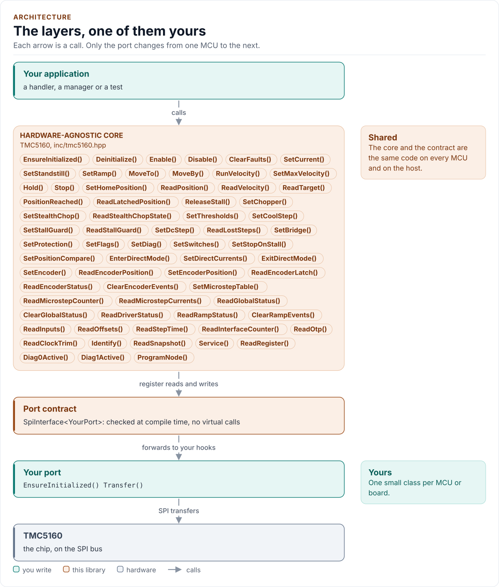
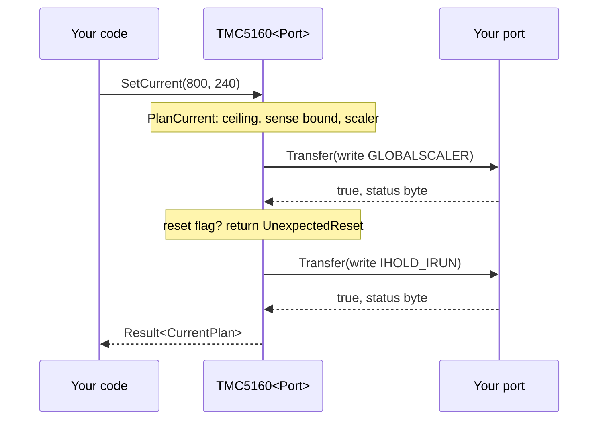

# Architecture

How the driver is built: three layers, one of them yours, and what happens in each when you move the motor.

<!-- generated: datasheet-refs -->
??? abstract "Datasheet sections this page relies on"

    From Analog Devices (Trinamic) TMC5160A-DS 1.18:

    - Features, control interfaces and key concepts: 1 Principles of Operation, p. 5
    - Initialization examples: 23.1 Initialization Examples, p. 116

    All of them, with the driver API for each: [Datasheet map](datasheet.md).
<!-- /generated -->

<!-- figure: driver-layers -->
<picture>
  <source media="(prefers-color-scheme: dark)" srcset="diagrams/driver-layers.dark.svg">
  
</picture>
<!-- /figure -->

## Layers

| Layer | Files | Owns |
| --- | --- | --- |
| Core | [`inc/tmc5160.hpp`](../inc/tmc5160.hpp), [`src/tmc5160.ipp`](../src/tmc5160.ipp) | Lifecycle, guards, motion, status, framing of both buses, errors |
| Types and registers | [`inc/tmc5160_types.hpp`](../inc/tmc5160_types.hpp), [`inc/tmc5160_registers.hpp`](../inc/tmc5160_registers.hpp), [`inc/tmc5160_status.hpp`](../inc/tmc5160_status.hpp) | `Error`, `Result<T>`, `Config` and its parts; the register table; decoded status |
| Units | [`inc/tmc5160_units.hpp`](../inc/tmc5160_units.hpp) | Pure integer helpers: the current plan, ramp conversions, the encoder scale |
| Helpers | [`inc/tmc5160_detail.hpp`](../inc/tmc5160_detail.hpp) | Typed integer literals, the exact hook probes, CRC-8, field packing |
| Port contracts | [`inc/tmc5160_spi_interface.hpp`](../inc/tmc5160_spi_interface.hpp), [`inc/tmc5160_uart_interface.hpp`](../inc/tmc5160_uart_interface.hpp) | The CRTP bases, the concepts, the bus requirements |
| Platform port | Your class | Bus bring-up and byte transfers, optionally delays, GPIO, the clock and logging |
| Kconfig layer | [`inc/tmc5160_kconfig.hpp`](../inc/tmc5160_kconfig.hpp) | Optional: a `Config` from ESP-IDF menuconfig |

## One call through the layers

## Design choices

- **CRTP, not virtual functions.** The port is a template parameter constrained by the `SpiPort` or `UartPort` concept,
  so every call is resolved at compile time and a missing hook is a compile error that names it.
- **One bus per object.** The base class decides the bus; the framing code is `if constexpr` on it, so a UART port carries
  no SPI code.
- **A shadow of the write-only registers.** Most TMC5160 registers cannot be read. The driver writes whole 32-bit words
  from a write-through shadow and never reads them back; this also makes `UnexpectedReset` detectable and recoverable.
- **The configuration is the source of truth.** Every setter builds the next `Config`, validates it, writes the affected
  registers and only then stores it, so a failed call leaves the stored configuration as it was.
- **Guards in one place.** Every dangerous write goes through one guard function that knows the acknowledgements.
- **Optional hooks by `requires`.** `DelayUs`, `GpioSet`, `GpioGet`, `SckHz` and `Log` are detected in one place.
- **No I/O in the constructor.** Construction cannot fail, so the driver can be a static or a member of a handler.
- **One error type.** `Result<T>` carries a value and an `Error`; nothing throws and nothing returns a bare `bool`.
- **No heap, no exceptions, no RTTI, no `std::function`, no `printf`.** The driver is a header-only template with no
  mutable static state.

## Source map

| You want | Read |
| --- | --- |
| The public API | [`inc/tmc5160.hpp`](../inc/tmc5160.hpp) |
| How a call is implemented | [`src/tmc5160.ipp`](../src/tmc5160.ipp) |
| Register addresses and bits | [`inc/tmc5160_registers.hpp`](../inc/tmc5160_registers.hpp) |
| The current arithmetic | [`inc/tmc5160_units.hpp`](../inc/tmc5160_units.hpp) |
| The port contracts | [`inc/tmc5160_spi_interface.hpp`](../inc/tmc5160_spi_interface.hpp), [`inc/tmc5160_uart_interface.hpp`](../inc/tmc5160_uart_interface.hpp) |

Next: [Contract](contract.md).
