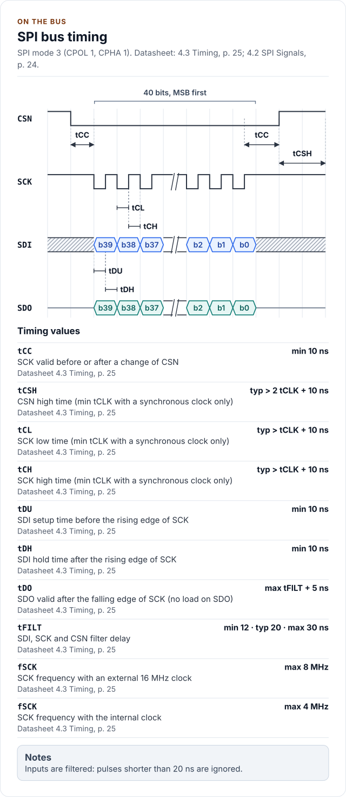
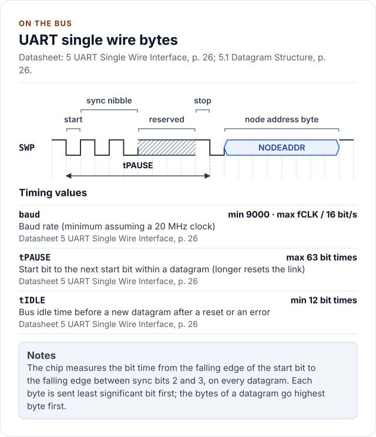
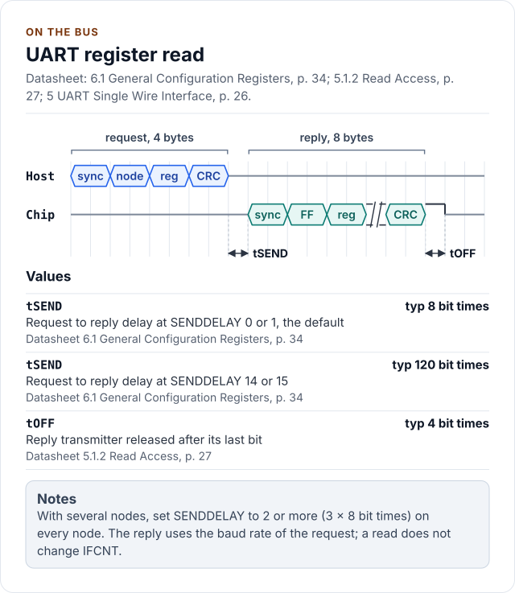
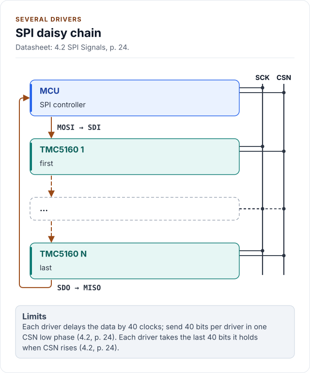
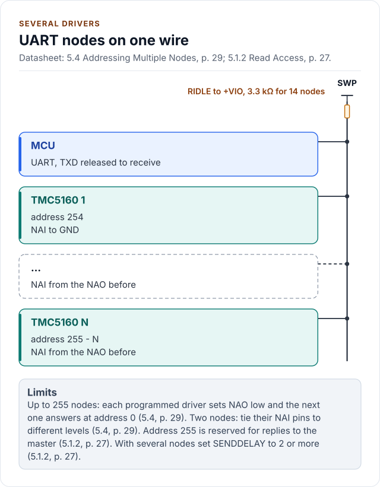

# On the bus

What the TMC5160 needs from its two control interfaces, signal by signal, with every time and rate taken from the
datasheet. The datagram contents are on the [SPI protocol](spi-protocol.md) and [UART protocol](uart-protocol.md)
pages; this page is the waveform under them.

## SPI timing

The TMC5160 reads SDI on the rising edge of SCK and drives SDO after the falling edge, with SCK idle high: SPI mode 3.
One datagram is 40 bits, MSB first, inside one CSN low phase; the chip takes the command when CSN rises.

<!-- figure: spi-timing -->
<picture>
  <source media="(prefers-color-scheme: dark)" srcset="diagrams/spi-timing.dark.svg">
  
</picture>
<!-- /figure -->

## UART single wire

In UART mode (`SPI_MODE` and `SD_MODE` low) host and chip share SWP. Every datagram starts with the sync nibble, from
which the chip measures the baud rate, so any rate from 9000 baud to `fCLK / 16` works without configuration.

<!-- figure: uart-timing -->
<picture>
  <source media="(prefers-color-scheme: dark)" srcset="diagrams/uart-timing.dark.svg">
  
</picture>
<!-- /figure -->

A read is a four-byte request; the chip waits the SENDDELAY time, answers with eight bytes at the same baud rate and
releases the line four bit times after its last bit.

<!-- figure: uart-read -->
<picture>
  <source media="(prefers-color-scheme: dark)" srcset="diagrams/uart-read.dark.svg">
  
</picture>
<!-- /figure -->

## Several devices

On SPI the TMC5160 can be daisy chained: bits clocked beyond 40 leave on SDO 40 clocks later, and each chip takes the
last 40 bits it holds when CSN rises (section 4.2).

<!-- figure: spi-chain -->
<picture>
  <source media="(prefers-color-scheme: dark)" srcset="diagrams/spi-chain.dark.svg">
  
</picture>
<!-- /figure -->

On the single wire UART up to 255 nodes share SWP. Each chip answers its NODEADDR; the NAO output of one chip feeds
NAI of the next, so the nodes can be given their addresses one after the other (section 5.4).

<!-- figure: uart-topology -->
<picture>
  <source media="(prefers-color-scheme: dark)" srcset="diagrams/uart-topology.dark.svg">
  
</picture>
<!-- /figure -->

## How these figures are made

Each figure is a model in `docs/model/` (`spi-timing.timing.yml`, `uart-timing.timing.yml`, `uart-read.timing.yml`,
`spi-chain.topology.yml` and `uart-topology.topology.yml`) that cites the datasheet section and page of every number;
`kokeb-docs figures` draws it and the build fails on a number without a citation. The values table under each
waveform is also written as `docs/diagrams/<id>.table.html`.
