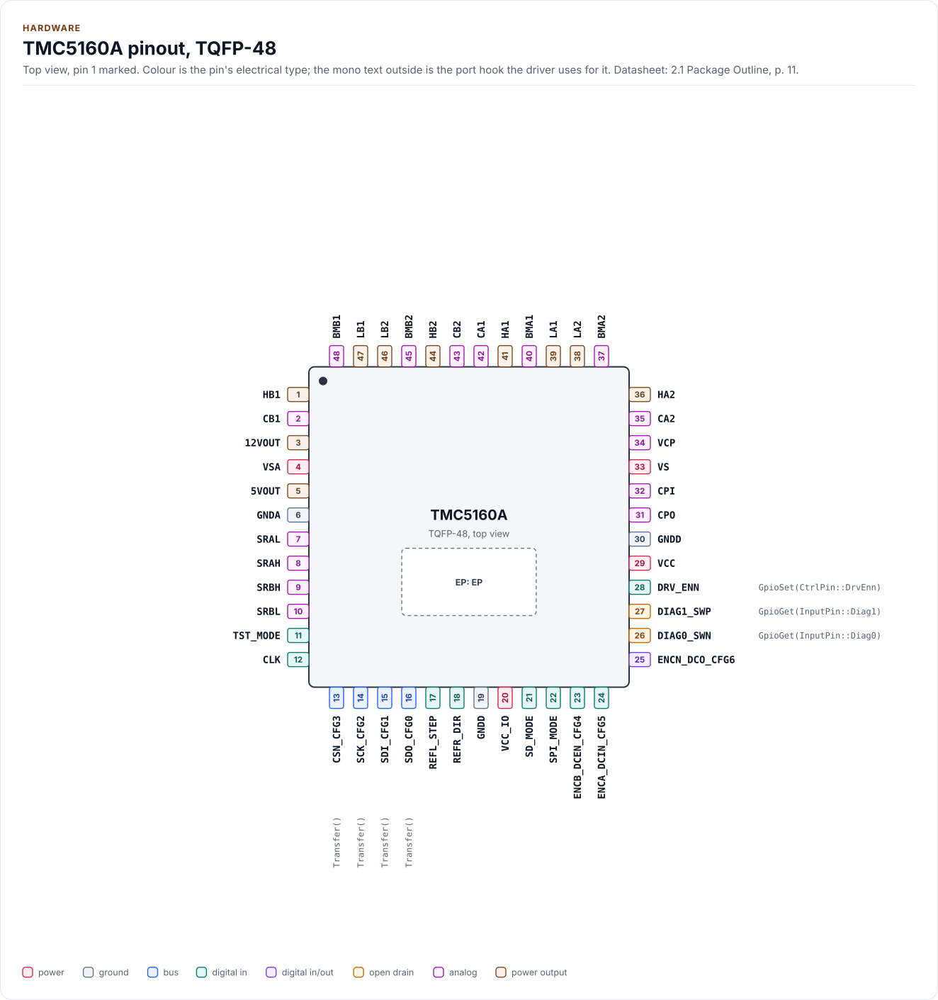
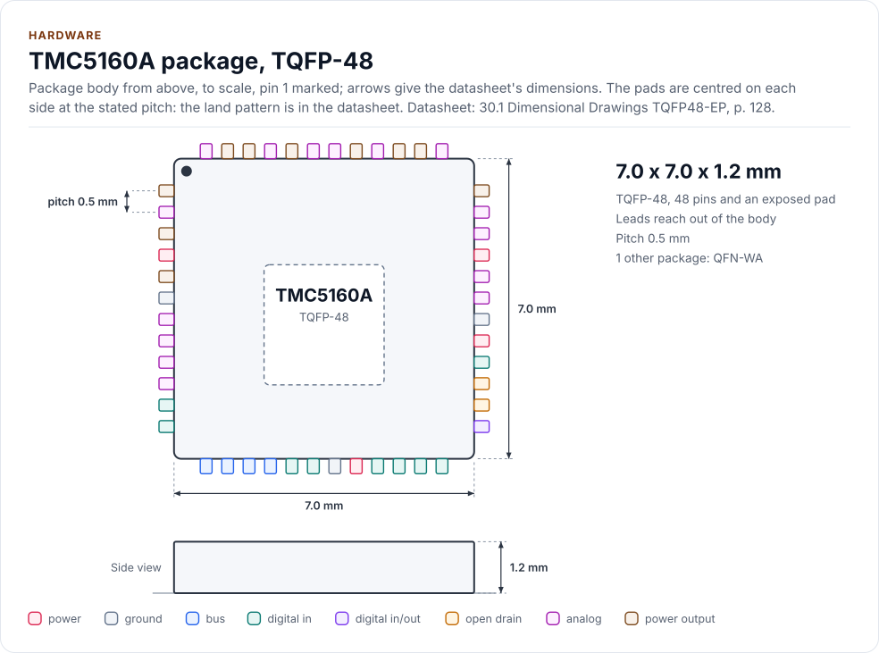
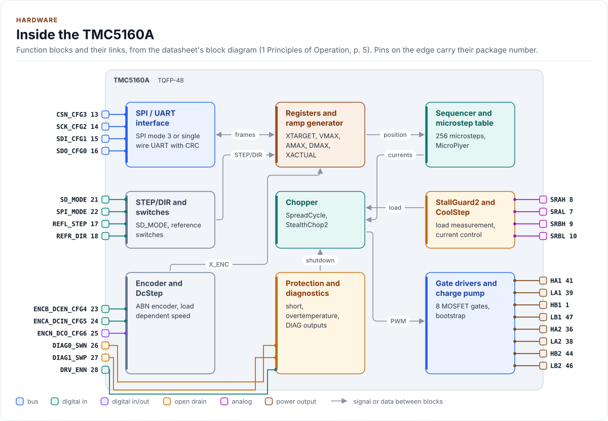
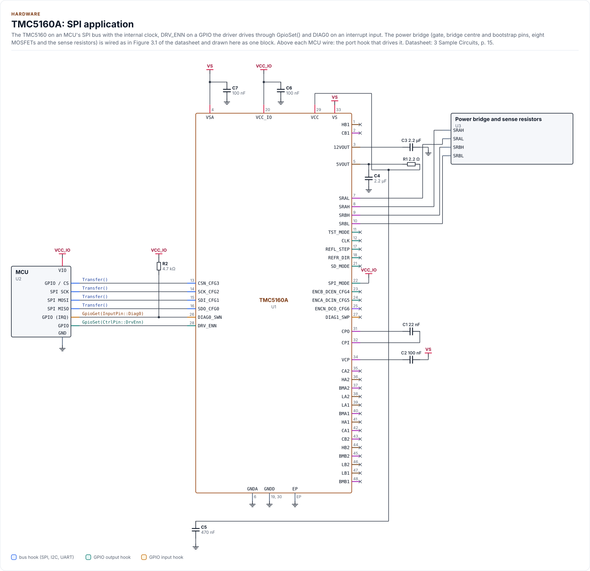
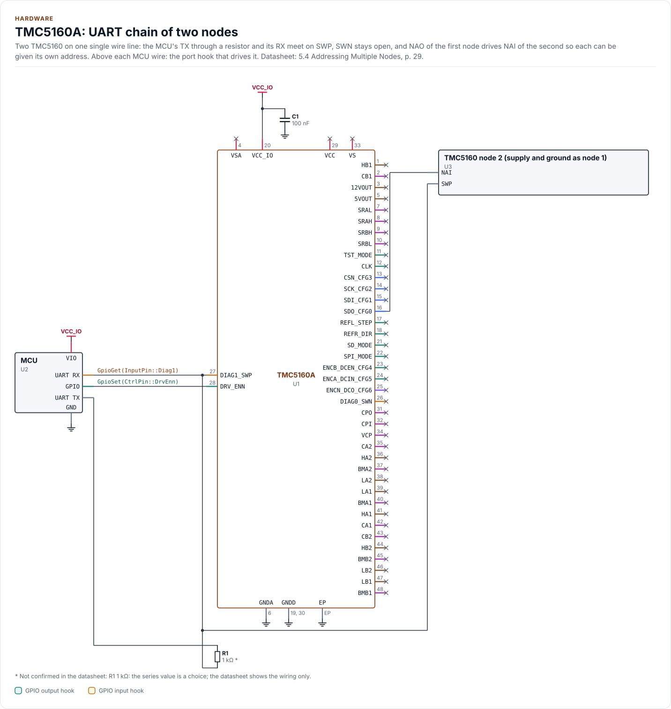

# Hardware

The TMC5160A's package, pins, bus settings, timing and power, as the driver uses them.

<!-- generated: datasheet-refs -->
??? abstract "Datasheet sections this page relies on"

    From Analog Devices (Trinamic) TMC5160A-DS 1.18:

    - Package, pins and signal descriptions: 2 Pin Assignments, p. 11
    - Sample circuits and gate drive: 3 Sample Circuits, p. 15
    - Absolute maximum ratings and operational range: 28.1 Operational Range, p. 120
    - DC and timing characteristics: 28.2 DC and Timing Characteristics, p. 121
    - Thermal characteristics: 28.3 Thermal Characteristics, p. 124
    - Package mechanical data and codes: 30 Package Mechanical Data, p. 128

    All of them, with the driver API for each: [Datasheet map](datasheet.md).
<!-- /generated -->

The driver drives only `DRV_ENN` of the control pins. `CtrlPin::DcEnable` and `CtrlPin::DcIn` exist for a port that wires
them, `InputPin::DcOut` likewise: no call of the driver sets or reads them.

## Package and pins

The TMC5160 and TMC5160A are sold in a 48-pin TQFP with exposed pad (7 x 7 mm, 0.5 mm pitch) and in a wettable-flank QFN
(8 x 8 mm). The driver uses the same registers on both.

<!-- figure: chip-pinout -->
<picture>
  <source media="(prefers-color-scheme: dark)" srcset="diagrams/chip-pinout.dark.svg">
  
</picture>
<!-- /figure -->

<!-- figure: chip-outline -->
<picture>
  <source media="(prefers-color-scheme: dark)" srcset="diagrams/chip-outline.dark.svg">
  
</picture>
<!-- /figure -->

<!-- generated: chip-pins -->
TQFP-48, 48 pins and an exposed pad (2.1 Package Outline, p. 11).

| Pin | Name | Type (domain) | Function | Driver hook | If unused | Datasheet |
| --- | --- | --- | --- | --- | --- | --- |
| 1 | `HB1` | power output (VS) | High-side gate driver output, bridge B1 | - | - | 2.2, p. 12 |
| 2 | `CB1` | analog (VS) | Bootstrap capacitor positive, bridge B1 | - | - | 2.2, p. 12 |
| 3 | `12VOUT` | power output (VSA) | 11.5 V gate regulator output; supplies the low-side drivers | - | - | 2.2, p. 12 |
| 4 | `VSA` | power (VSA) | Analog supply for the 11.5 V and 5 V regulators | - | - | 2.2, p. 12 |
| 5 | `5VOUT` | power output (VSA) | 5 V regulator output | - | - | 2.2, p. 12 |
| 6 | `GNDA` | ground | Analog ground | - | - | 2.2, p. 12 |
| 7 | `SRAL` | analog (VS) | Sense resistor A, ground side | - | - | 2.2, p. 12 |
| 8 | `SRAH` | analog (VS) | Sense resistor A, upper side | - | - | 2.2, p. 12 |
| 9 | `SRBH` | analog (VS) | Sense resistor B, upper side | - | - | 2.2, p. 12 |
| 10 | `SRBL` | analog (VS) | Sense resistor B, ground side | - | - | 2.2, p. 12 |
| 11 | `TST_MODE` | digital in (VCC_IO) | Test mode; tie to GND | - | Tie to GND | 2.2, p. 12 |
| 12 | `CLK` | digital in (VCC_IO) | Clock input, 4 to 18 MHz; GND selects the internal 12 MHz oscillator | - | Tie to GND | 2.2, p. 12 |
| 13 | `CSN_CFG3` | bus (VCC_IO) | SPI chip select, active low | `Transfer()` | - | 2.2, p. 12 |
| 14 | `SCK_CFG2` | bus (VCC_IO) | SPI clock, mode 3, up to 4 MHz on the internal clock | `Transfer()` | - | 2.2, p. 12 |
| 15 | `SDI_CFG1` | bus (VCC_IO) | SPI data in; NAI in UART mode | `Transfer()` | - | 2.2, p. 12 |
| 16 | `SDO_CFG0` | bus (VCC_IO) | SPI data out, tristate; NAO in UART mode | `Transfer()` | - | 2.2, p. 12 |
| 17 | `REFL_STEP` | digital in (VCC_IO) | Left reference switch or STEP input | - | Tie to GND | 2.2, p. 12 |
| 18 | `REFR_DIR` | digital in (VCC_IO) | Right reference switch or DIR input | - | Tie to GND | 2.2, p. 12 |
| 19 | `GNDD` | ground | Digital ground | - | - | 2.2, p. 12 |
| 20 | `VCC_IO` | power (VCC_IO) | 3.0 V to 5.25 V I/O supply | - | - | 2.2, p. 12 |
| 21 | `SD_MODE` | digital in (VCC_IO) | Low: ramp generator; high: STEP/DIR; both strap pins low: UART | - | Tie to GND | 2.2, p. 12 |
| 22 | `SPI_MODE` | digital in (VCC_IO) | High: SPI; low with SD_MODE low: UART; internal pull-down | - | - | 2.2, p. 12 |
| 23 | `ENCB_DCEN_CFG4` | digital in (VCC_IO) | Encoder B, DcStep enable or CFG4; internal pull-down | - | Tie to GND | 2.2, p. 12 |
| 24 | `ENCA_DCIN_CFG5` | digital in (VCC_IO) | Encoder A, DcStep input, emergency stop or CFG5; internal pull-down | - | Tie to GND | 2.2, p. 12 |
| 25 | `ENCN_DCO_CFG6` | digital in/out (VCC_IO) | Encoder N, DcStep ready output or CFG6 | - | Tie to GND | 2.2, p. 12 |
| 26 | `DIAG0_SWN` | open drain (VCC_IO) | DIAG0 interrupt or STEP output; SWN of the single wire interface; open drain, 47 k pull-up or less | `GpioGet(InputPin::Diag0)` | Leave open | 2.2, p. 12 |
| 27 | `DIAG1_SWP` | open drain (VCC_IO) | DIAG1 position compare or DIR output; SWP of the single wire interface; open drain, internal pull-down | `GpioGet(InputPin::Diag1)` | Leave open | 2.2, p. 12 |
| 28 | `DRV_ENN` | digital in (VCC_IO) | Driver enable, active low | `GpioSet(CtrlPin::DrvEnn)` | - | 2.2, p. 12 |
| 29 | `VCC` | power (VSA) | 5 V digital supply, from 5VOUT through 2.2 ohm | - | - | 2.2, p. 12 |
| 30 | `GNDD` | ground | Digital ground | - | - | 2.2, p. 12 |
| 31 | `CPO` | analog (VS) | Charge pump capacitor output | - | - | 2.2, p. 12 |
| 32 | `CPI` | analog (VS) | Charge pump capacitor input | - | - | 2.2, p. 12 |
| 33 | `VS` | power (VS) | Motor and bridge supply, 10 V to 55 V | - | - | 2.2, p. 12 |
| 34 | `VCP` | analog (VS) | Charge pump voltage | - | - | 2.2, p. 12 |
| 35 | `CA2` | analog (VS) | Bootstrap capacitor positive, bridge A2 | - | - | 2.2, p. 12 |
| 36 | `HA2` | power output (VS) | High-side gate driver output, bridge A2 | - | - | 2.2, p. 12 |
| 37 | `BMA2` | analog (VS) | Bridge centre A2 | - | - | 2.2, p. 12 |
| 38 | `LA2` | power output (VSA) | Low-side gate driver output, bridge A2 | - | - | 2.2, p. 12 |
| 39 | `LA1` | power output (VSA) | Low-side gate driver output, bridge A1 | - | - | 2.2, p. 12 |
| 40 | `BMA1` | analog (VS) | Bridge centre A1 | - | - | 2.2, p. 12 |
| 41 | `HA1` | power output (VS) | High-side gate driver output, bridge A1 | - | - | 2.2, p. 12 |
| 42 | `CA1` | analog (VS) | Bootstrap capacitor positive, bridge A1 | - | - | 2.2, p. 12 |
| 43 | `CB2` | analog (VS) | Bootstrap capacitor positive, bridge B2 | - | - | 2.2, p. 12 |
| 44 | `HB2` | power output (VS) | High-side gate driver output, bridge B2 | - | - | 2.2, p. 12 |
| 45 | `BMB2` | analog (VS) | Bridge centre B2 | - | - | 2.2, p. 12 |
| 46 | `LB2` | power output (VSA) | Low-side gate driver output, bridge B2 | - | - | 2.2, p. 12 |
| 47 | `LB1` | power output (VSA) | Low-side gate driver output, bridge B1 | - | - | 2.2, p. 12 |
| 48 | `BMB1` | analog (VS) | Bridge centre B1 | - | - | 2.2, p. 12 |
| EP | `EP` | ground | Exposed die pad: GNDD and GNDP, the heat path | - | - | 2.2, p. 12 |

Source of this table and of the chip figures: [`docs/hardware.yml`](hardware.yml).
<!-- /generated -->

## Block diagram

<!-- figure: chip-blocks -->
<picture>
  <source media="(prefers-color-scheme: dark)" srcset="diagrams/chip-blocks.dark.svg">
  
</picture>
<!-- /figure -->

## Reference circuits

The circuits are drawn from [`hardware.yml`](hardware.yml); the part values are the datasheet's (Figure 3.1) except where
marked.

<!-- figure: chip-circuit-spi-typical -->
<picture>
  <source media="(prefers-color-scheme: dark)" srcset="diagrams/chip-circuit-spi-typical.dark.svg">
  
</picture>
<!-- /figure -->

<!-- figure: chip-circuit-uart-chain -->
<picture>
  <source media="(prefers-color-scheme: dark)" srcset="diagrams/chip-circuit-uart-chain.dark.svg">
  
</picture>
<!-- /figure -->

In UART mode the MCU's TX and RX wires to SWP are the `Exchange()` hook, and DIAG0 and DIAG1 are not available (their
pins are the single wire interface, [UART protocol](uart-protocol.md)). The figure still labels those pins with their
SPI-mode hooks until the figure tool can give one circuit its own hooks.

<!-- generated: chip-parts -->
**SPI application** (figure `chip-circuit-spi-typical`)

| Part | Kind | Value | Connects | Datasheet |
| --- | --- | --- | --- | --- |
| U2 | MCU | - | VIO: VCC_IO, GND: GND, SCK: SCLK, MOSI: SDI, MISO: SDO, CS: CSN, ENN: DRV_ENN, IRQ: DIAG0 | 3, p. 15 |
| U3 | Power bridge and sense resistors | - | SRAH: SRAH, SRAL: SRAL, SRBH: SRBH, SRBL: SRBL | 3, p. 15 |
| C1 | capacitor | 22 nF | CPI, CPO | 3, p. 15 |
| C2 | capacitor | 100 nF | VS, VCP | 3, p. 15 |
| C3 | capacitor | 2.2 µF | GND, 12VOUT | 3, p. 15 |
| C4 | capacitor | 2.2 µF | GND, 5VOUT | 3, p. 15 |
| C5 | capacitor | 470 nF | GND, VCC | 3, p. 15 |
| C6 | capacitor | 100 nF | VCC_IO, GND | 3, p. 15 |
| C7 | capacitor | 100 nF | VS, GND | 3, p. 15 |
| R1 | resistor | 2.2 Ω | 5VOUT, VCC | 3, p. 15 |
| R2 | resistor | 4.7 kΩ | VCC_IO, DIAG0 | 2.2, p. 12 |

**UART chain of two nodes** (figure `chip-circuit-uart-chain`)

| Part | Kind | Value | Connects | Datasheet |
| --- | --- | --- | --- | --- |
| U2 | MCU | - | VIO: VCC_IO, GND: GND, RX: SWP, TX: TX, ENN: DRV_ENN | 5.4, p. 29 |
| U3 | TMC5160 node 2 (supply and ground as node 1) | - | SWP: SWP, NAI: NAO | 5.4, p. 29 |
| R1 | resistor | 1 kΩ (not confirmed: the series value is a choice; the datasheet shows the wiring only) | SWP, TX | 5.4, p. 29 |
| C1 | capacitor | 100 nF | VCC_IO, GND | 3, p. 15 |

Export a circuit for a schematic or PCB tool: `kokeb-docs hardware --kicad-netlist OUT.net --circuit spi-typical`.
<!-- /generated -->

## Operating modes and straps

| Mode | SD_MODE | SPI_MODE | Interface | Driver |
| --- | --- | --- | --- | --- |
| Motion controller | low | high (SPI) or low (UART) | SPI or UART | `Mode::MotionController` |
| STEP/DIR with serial configuration | high | high | SPI | `Mode::StepDir` |
| Standalone STEP/DIR, configured by the CFG pins | high | low | none | not drivable |

`EnsureInitialized()` reads IOIN and compares the SD_MODE level with `Config::mode`; a mismatch returns `ModeMismatch`.

## Control pins

The driver drives DRV_ENN, and no other control pin, through the optional `GpioSet()` hook, with
logical levels: `GpioSignal::ACTIVE` means "driver enabled", which your port writes as a low level on DRV_ENN. A board
that wires DRV_ENN low permanently leaves the hook out: `Enable()` then writes TOFF only, and `Disable()` writes TOFF 0.
Configure the pin with the driver off before it becomes an output.

DIAG0 and DIAG1 are read with `GpioGet()`. They are open drain by default and need a pull-up of 47 kOhm or less.

## Supplies

| Rail | Range | Source |
| --- | --- | --- |
| VS | 10 V to 55 V | Motor and bridge supply (section 28.1, page 120) |
| VSA | 10 V to 50 V | Analog supply for the 11.5 V and 5 V regulators |
| VCC_IO | 3.0 V to 5.25 V | I/O supply, sets the logic levels |

The cover page says 8 V to 60 V; the driver uses the operating range of page 120 ([Ambiguities](ambiguities.md), A50).
The slopes of VS at power-on and power-off must stay below 1 V per microsecond, and ripple above 0.5 V endangers the
charge pump (pages 15 and 16).

## Clock

The internal oscillator runs at about 12 MHz (practical tolerance 4 percent); an external clock of 4 MHz to 18 MHz on CLK
is accepted (10 to 16 MHz advised). Every time, velocity and acceleration value scales with the clock, so declare it in
`Config::clock`.

## Bus settings

| Setting | SPI | UART |
| --- | --- | --- |
| Mode | Mode 3: SCK idle high, sampled on the rising edge | 8N1, LSB first |
| Clock | Up to 4 MHz on the internal clock, `fCLK / 2` less a 10 percent margin on an external one | 9000 baud to `fCLK / 16`, set from the sync nibble |
| Frame | 40 bits, CSN low for the whole frame | 8 bytes write, 4 bytes read request, 8 bytes reply |
| Integrity | none | CRC-8 |

SPI timing (section 4.3, page 25): CSN high time more than `2 tCLK + 10 ns`, SCK high and low more than `tCLK + 10 ns`,
SDI setup and hold 10 ns. The driver does not time the bus: the port's clock sets it.

## Timing the driver waits for

| Parameter | Value | Driver |
| --- | --- | --- |
| Interface idle after a UART error | 12 bit times | `kUartRecoveryBits` |
| StealthChop automatic tuning AT#1 | up to 130 ms | `SetStealthChop()` waits with bounded `DelayUs()` calls |
| DRV_ENN switch-off | 3 clock cycles | `Disable()` |

## Reset

A chip reset (undervoltage on VSA, 5VOUT or VCC_IO, or power-up) sets every register to its reset value. VCC is not
monitored (section 25, page 119). After a microcontroller reboot the datasheet asks: TOFF 0, rewrite all registers, stop
the ramp. `EnsureInitialized()` does exactly that; the driver never relies on the chip's registers surviving.

## Reference documents

The datasheet:
[TMC5160/TMC5160A datasheet](https://www.analog.com/media/en/technical-documentation/data-sheets/TMC5160A_datasheet_rev1.18.pdf).
Every pin, setting and timing on this page cites a section of it; its revision, its SHA-256 and the sections each page
relies on are in [`docs/datasheets.yml`](datasheets.yml).

<!-- generated: datasheet-card -->
| Document | Revision | Get it |
| --- | --- | --- |
| Datasheet: TMC5160 / TMC5160A Datasheet (Analog Devices (Trinamic) TMC5160A-DS) | 1.18, 2023-03-01 | [vendor page](https://www.analog.com/media/en/technical-documentation/data-sheets/TMC5160A_datasheet_rev1.18.pdf) |

Written against these revisions; the SHA-256 of each file is in [`docs/datasheets.yml`](datasheets.yml). Where each part
of the driver is in the datasheet: [Datasheet map](datasheet.md).
<!-- /generated -->

| Also useful | Contents |
| --- | --- |
| [`inc/tmc5160_registers.hpp`](../inc/tmc5160_registers.hpp) | The register map as the driver uses it, with datasheet section numbers |
| [Coverage map](coverage.md) | Every pin and rating of the datasheet and where the driver handles it |
