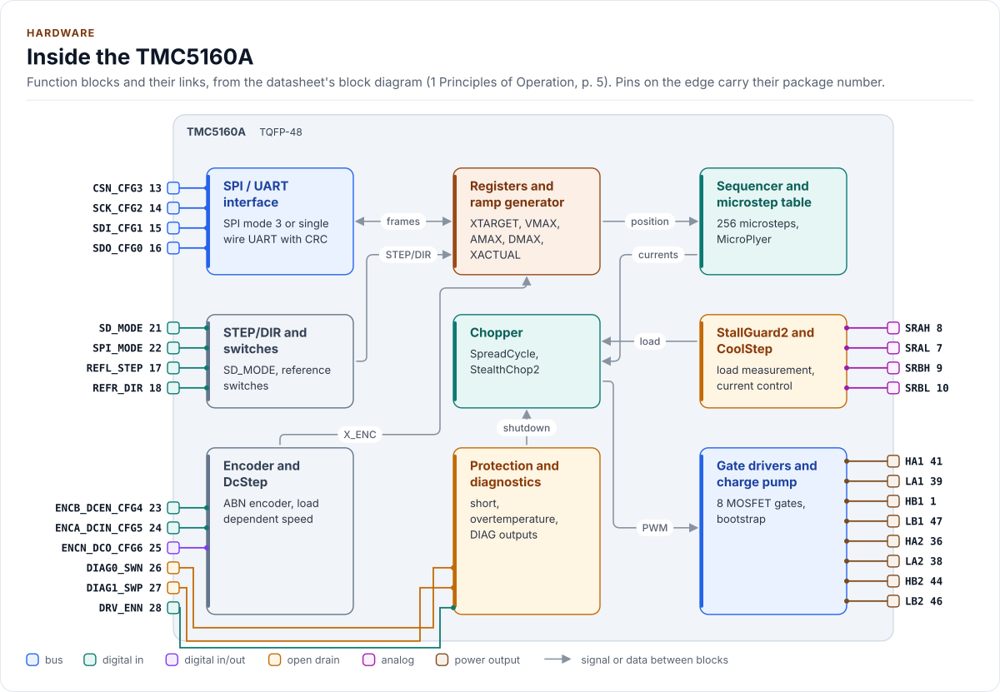
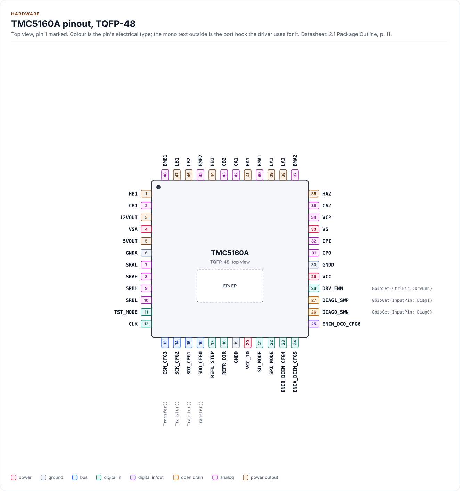

---
hide:
  - navigation
  - toc
---

<div class="kb-hero" markdown>
<span class="kb-kicker">Stepper motor controller and driver</span>

# TMC5160 Driver

<p>A C++20 driver for the TMC5160 and TMC5160A stepper motor controller and driver. It starts the chip safely,
moves the motor in physical units, and refuses the register writes that can burn out a motor or a bridge, on any MCU,
over SPI or UART.</p>

[Quickstart](quickstart.md){ .md-button .md-button--primary }
[API guide](api-guide.md){ .md-button }
[Source on GitHub](https://github.com/kokeb-labs-drivers/driver-tmc5160){ .md-button }
</div>

<!-- generated: chip-summary -->
The **TMC5160A** is a controller and driver for two-phase bipolar stepper motors: it runs the motion profile itself and
drives an external MOSFET bridge for coil currents from 1 A to several 10 A (Title page, p. 1).
<!-- /generated -->

<!-- figure: chip-hero -->
<picture>
  <source media="(prefers-color-scheme: dark)" srcset="diagrams/chip-hero.dark.svg">
  
</picture>
<!-- /figure -->

## What it does

<!-- figure: chip-capabilities -->
<picture>
  <source media="(prefers-color-scheme: dark)" srcset="diagrams/chip-capabilities.dark.svg">
  
</picture>
<!-- /figure -->

## Where it is used

<!-- generated: chip-uses -->
- Robotics and industrial drives
- Textile and sewing machines
- Packing machines
- Factory and lab automation
- High-speed 3D printers
- Liquid handling and medical equipment
- Office automation, CCTV, ATMs and cash recyclers
- Pumps and valves

Uses named by the datasheet (Title page, p. 1).
<!-- /generated -->

## Inside the chip

<!-- figure: chip-blocks -->
<picture>
  <source media="(prefers-color-scheme: dark)" srcset="diagrams/chip-blocks.dark.svg">
  
</picture>
<!-- /figure -->

## Pins and wiring

<!-- figure: chip-pinout -->
<picture>
  <source media="(prefers-color-scheme: dark)" srcset="diagrams/chip-pinout.dark.svg">
  
</picture>
<!-- /figure -->

<!-- figure: chip-wiring-spi-typical -->
<picture>
  <source media="(prefers-color-scheme: dark)" srcset="diagrams/chip-wiring-spi-typical.dark.svg">
  
</picture>
<!-- /figure -->

<!-- figure: chip-frame-spi -->
<picture>
  <source media="(prefers-color-scheme: dark)" srcset="diagrams/chip-frame-spi.dark.svg">
  
</picture>
<!-- /figure -->

Every pin, the sample circuits, the bus settings, the timing and the power: [Hardware](hardware.md).

## Quick start

Wire the chip as above, write the port ([Porting](porting.md)), then declare the motor and move it:

```cpp
--8<-- "tests/docs/quickstart.cpp:quickstart"
```

The steps explained: [Quickstart](quickstart.md).

## Driver coverage

<!-- generated: chip-coverage -->
| Capability | What the chip does | Driver API | Registers | Status | Datasheet |
| --- | --- | --- | --- | --- | --- |
| [Motion controller and homing](motion.md) | Moves to a target or runs at a velocity on its own ramp; stops and latches the position at switches | `SetRamp`, `MoveTo`, `MoveBy`, `RunVelocity`, `Stop`, `SetSwitches`, `ReadLatchedPosition` | `RAMPMODE`, `XTARGET`, `VMAX`, `AMAX`, `XACTUAL`, `SW_MODE`, `XLATCH`, `RAMP_STAT` | Supported | 12, p. 81 |
| [STEP/DIR input](special-modes.md) | Takes step pulses from your MCU instead, interpolated to 256 microsteps by MicroPlyer | `Mode::StepDir` | `CHOPCONF` | Supported | 15, p. 94 |
| [Motor current](current-and-limits.md) | Sets run and hold current from the motor rating and the sense resistor, and powers down at standstill | `SetCurrent`, `SetStandstill` | `GLOBALSCALER`, `IHOLD_IRUN`, `TPOWERDOWN` | Supported | 1.4, p. 8 |
| [StealthChop2 and SpreadCycle](chopper.md) | Silent voltage-mode chopping at low speed, cycle-by-cycle current chopping at high speed | `SetStealthChop`, `ReadStealthChopState`, `SetChopper`, `SetThresholds` | `PWMCONF`, `CHOPCONF`, `TPWMTHRS`, `THIGH`, `PWM_SCALE`, `PWM_AUTO` | Supported | 7, p. 57 |
| [StallGuard2, CoolStep and DcStep](stallguard-and-coolstep.md) | Senses the load without a sensor: detects a stall, saves current at light load, slows under overload | `SetStallGuard`, `SetCoolStep`, `ReadStallGuard`, `SetStopOnStall`, `SetDcStep`, `ReadLostSteps` | `COOLCONF`, `TCOOLTHRS`, `DRV_STATUS`, `DCCTRL`, `VDCMIN`, `LOST_STEPS` | Supported | 13, p. 87 |
| [Encoder input](special-modes.md) | Counts an ABN incremental encoder and flags a deviation from the commanded position | `SetEncoder`, `ReadEncoderPosition`, `ReadEncoderStatus` | `ENCMODE`, `X_ENC`, `ENC_CONST`, `ENC_DEVIATION` | Supported | 20, p. 107 |
| [Bridge and protection](guards.md) | Short, overtemperature and gate-drive settings; a wrong value can destroy the bridge | `SetBridge`, `SetProtection`, `ReadDriverStatus`, `ReadGlobalStatus` | `DRV_CONF`, `SHORT_CONF`, `GSTAT`, `DRV_STATUS` | Guarded | 11, p. 78 |
| [SPI chain and UART nodes](uart-protocol.md) | Several chips on one SPI daisy chain or one single wire UART, each with its own address | `ProgramNode`, `ReadInterfaceCounter` | `NODECONF`, `IFCNT` | Supported | 5.4, p. 29 |
| [OTP programming](coverage.md) | One-time programmable defaults in the chip; the driver reads them and never programs them | `ReadOtp` | `OTP_PROG`, `OTP_READ` | Not covered | 6.1, p. 32 |

**Supported**: the driver covers it and a host test checks it; **Guarded**: covered, behind an explicit acknowledgement
because a wrong value can do harm; **Not covered**: the chip has it and the driver leaves it alone.

From [`docs/hardware.yml`](hardware.yml); `kokeb-docs hardware --check` confirms that every API name is in
`inc/tmc5160.hpp`, `inc/tmc5160_types.hpp` and every register in `inc/tmc5160_registers.hpp`.
<!-- /generated -->

The driver has no platform code. You give it a small class that brings the bus up and moves bytes; it does the rest:
the start-up sequence, the datagram framing and CRC, the current arithmetic, the ramp registers, the guards and the
timeouts. Nothing here has run on a chip yet: it is tested against an independent model of the TMC5160 (see
[Testing and CI](testing.md)).

- **One object per chip.** `TMC5160<YourPort>` takes a reference to your port and does no I/O until
  `EnsureInitialized()`. See [API guide](api-guide.md).
- **A current that cannot exceed the motor.** You declare the motor and the sense resistor; every register is derived
  from them. See [Current and limits](current-and-limits.md).
- **A guard for every dangerous write.** What the driver refuses, and the explicit acknowledgement that lifts a guard
  for one call. See [Guards and acknowledgements](guards.md).
- **Errors you can act on.** Every call returns `Result<T>` with an `Error` such as `Bus`, `Timeout`, `Refused` or
  `UnexpectedReset`. See [API guide](api-guide.md#handle-errors).
- **Both buses.** SPI and UART ports, daisy chains and multi-node lines, STEP/DIR mode. See
  [SPI protocol](spi-protocol.md) and [UART protocol](uart-protocol.md).
- **No heap, no exceptions, no RTTI.** The host tests build with `-fno-exceptions -fno-rtti`. See
  [Contract](contract.md).
- **Where the datasheet is unclear, a decision.** Fifty ambiguities are listed with the reading the driver takes.
  See [Ambiguities](ambiguities.md).

## Datasheet

<!-- generated: datasheet-card -->
| Document | Revision | Get it |
| --- | --- | --- |
| Datasheet: TMC5160 / TMC5160A Datasheet (Analog Devices (Trinamic) TMC5160A-DS) | 1.18, 2023-03-01 | [vendor page](https://www.analog.com/media/en/technical-documentation/data-sheets/TMC5160A_datasheet_rev1.18.pdf) |

Written against these revisions; the SHA-256 of each file is in [`docs/datasheets.yml`](datasheets.yml). Where each part
of the driver is in the datasheet: [Datasheet map](datasheet.md).
<!-- /generated -->

## Where to go next

<div class="grid cards" markdown>

-   :material-rocket-launch-outline: **[Quickstart](quickstart.md)**

    ---

    Wire the chip, write the port, declare the motor and move it in about 20 lines.

-   :material-chip: **[Hardware](hardware.md)**

    ---

    Pins, bus settings, timing and power.

-   :material-shield-check-outline: **[Guards and acknowledgements](guards.md)**

    ---

    What is refused, why, and how to lift a guard for one call.

-   :material-file-document-check-outline: **[Contract](contract.md)**

    ---

    What the driver promises, what it needs, threading and errors.

-   :material-code-braces: **[API guide](api-guide.md)**

    ---

    Start, set the current, move, tune and diagnose, task by task.

-   :material-swap-horizontal: **[Porting](porting.md)**

    ---

    Implement the SPI or UART port for your MCU.

</div>
